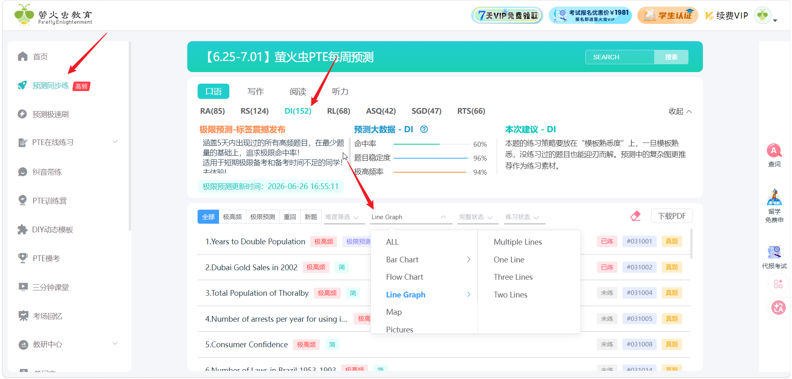
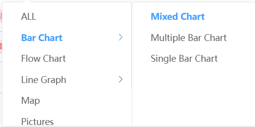
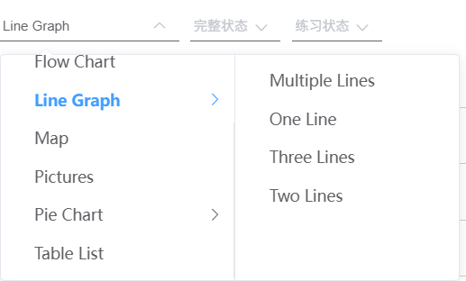

备考要点：

1、找到合适的模版，对自己来说易读易背的模版

2、一生只背一个模版，背的熟才是王道

3、了解 DI 所有的题型以及应该用哪个模版

4、DI  题型分列

​       数据类：line chart、bar chart、pie chart、table list

​       流程类：flow

​       图片类：picture、map

6、在萤火虫PTE去观看每种题型的解题思路视频



5、我总结了 4 套模版，如遇到多维度，应该使用 **极值多分类模版**

- 极值模版-单分类 （table 、 map 、 line chart 、bar chart 、pie chart）
- 极值模版-多分类 （table 、map 、 line chart 、bar chart 、pie chart）
- 流程图模版
- 图片模版       (图片、地图)







**极值模版-单分类** （table 、 map 、 line chart 、bar chart 、pie chart）

```JS
This line chart shows information about title.

Firstly,the highest number can be found in 最大项目，
           which is around 最大数值.
           
Secondly,the second highest number is located in 第二大项目,
           which is about 第二大数值.
           
Thirdly,the lowest figure is 最小项目，
           and the number is around 最小数值.
           
Furthermore,其他项目1 and 其他项目2 also carry important weight
in this graph.

In summary,this chart uses real data to describe 标题.

```

**极值模版-多分类** （table 、map 、 line chart 、bar chart 、pie chart）

```JS
this line chart shows information about 标题.

if you look at something1,
    the highest number can be found in 分类1最大项目，
                     which is aound 分类1最大数值,
                         
    the lowest figure is located in 分类1最小项目，
                     which is about 分类1最小数值.
                     
if you look at something2，
    the highest number is 分类2最大项目，
                     and the number is around 分类2最大数值.
                     
Furthermore,
    其他任意项目1 and 其他任意项目2 also carry important weight in this graph.
    
In summary,this chart uses real data to describe 标题.
           
```

**流程图模版**

```JS

This flow charts shows information about title.

According to the picture we can see that

firstly,the process starts from the first stage,
                        which is called step1.

Secondly,it gose to the second stage,
                        which is about step2.

Thridly,it comes to the third stage,
                        which is called step3.

Furthermore,the process comes to the ending point,
                        which is about END，
                        
In summary,the process shows details about 标题.
 
```

**图片模版**       (图片、地图)

```JS
This map shows information about title.

if you look at 图片1/方位1，
    the most obvious information given here is ___,
        
Next to it,
    we can see ___ and ___,
    and these two elements are also quite important.

If you look at 图片2/方位2,
    ___ and ___ are also shown in this part,
    giving a better understanding about this picture.
    
Furthermore,
    we can also see ___ and ___ in this picture as well.
    
In summary,
    this picture uses different elements to describe 标题.
```


```
the line chart shows information about __

Firstly, the highest number can be found in __, which is around __

Secondly, the second highest number is located in __, which is about __

Thirdly, the lowest figure is __  and the number is __

Furthermore, A and B also carry important weight in the graph.

In summary, the chart uses real data to illustrate __
```


```
the line chart shows information about __

If you look at __

the highest number can be found in   ___, which is around   __

the lowest fiure is __ and the number is __

If you look at __

the highest number can be found in __ ,which is around __

Futhermore, __ and __ also carry important weight in this graph.

In summary ,the chart uses real data to illustrate __
```


```
the flow chart show information about __

According to the picture we can see that 

Firstly, the process begins with the first step, 
  which is called __
Secondly,it gose to the second step,
 which is called __
Thirdly, it comes to the thrid step,
 which is called __
Furthermore, the process come to the ending point,
 which is called __
In summray, the process shows deatils about __
```


```
the picture shows information about __
If you look at __
 the most obvious information given here is __
Next to it __
 we can see __ and __, 
 and these two element are also quite important.
If you look at __
 __ and __ are also shown in this part,
 giving a better understanding about this pictuer.
Furthermore,
 we can see __ and __ in the picture as well.
In summary, the picture uses real data to illustrate __.
```


```
the lecture is mainly about __
At the beginning, the speaker introduces A
Then the speaker mentions B, which is ralted to B
Moreover, the speaker provodes several details about D and E
The lecture also gave some examples, such F
In summary, the lecure foucuses on __
```

```
the line chart shows information about __
Firstly, the highest nunber can be found in __, which is around __
Seocondly, the second highest number is located in __, which is about __
Thrirdly, the lowest figure is __ and the number is __
Furthermore, __ and __ also carry important weight in the graph
In summary, this chart uses real data to illustrate __
```

```
the line chart shows information about __
If you look at __
 the highest number can be found in __,
  which is around __
 the second highest number is located in __
  which is about __
If you look at __
 the highest number can be found in __
  which is around __
 the sencond highest number is located in __
  which is about __
Furthermore, __ and __ also carry important weight in this graph.
In summary, the chart uses real data to illustrate __.
```

```
the flow shows information about __
According to the picture,we can see that
firstly, the process starts form the first step
 which is called __
secondly, it goes to the second step,
 which is about __
thirdly, it comes to the third step,
 which is called __
furtermore, it comes to the ending point,
 which is about __
In summary, the chart shows deails about __.
```

```
the picture shows information about __
If you look at __
 the most obvious information given here is __
Next to it,
We can see __ and __,
 and these two elements are also quite important.
If you look at __
 __ and __ are also shown in this part,
 giving a better understaning about this pictuer.
Furthermore, we can see __ and __ in this pictuer as well.
In summary, the picture uses different elements to illustrate __.
```

Firtst of all
In additon

What's more

Last but not least 
however, therefore.

On the one hand, on the other hand


it is be of great significance.

I consider that __

what impressed me most is that __

I think it an honor that __

the more __, the more__

only in the way, can we __

prctice makes perfect!

With all the factors taken into consideration, __

no matter how difficult the problem is, I will spare no effort to complete it.


lay a solid foundation for 

pave the way for further learning

shoulder responsibility

boraden one's horizons


make contributions for society 

with the rapid development of AI

integrate theory and practice

focus on time and energy to do sth.


With the unprecedented pace of development in AI, the ability to do sth. is become increasing crucial for personal and professional success. In the following, I will share some of my insights about the topic.


**There is a growing debate over whether __**

In the following, I will share some of my insights in the 


DI模板、RL模板、RTS模板


there are three students discussing about __

for the first student, he **mentions** that A. He also argued that A.

for the second student, she agree that A, which is related to B. Moveover, she also provides some deatils about B.

for the second student, he also agreed with the first one, he believed __, he also gave some examples, such as __.


for the first student, he mentions A , he also argues that 

for the second student, he agree A ,  which is ralted to __. Moreover, he also provides some deatils about __

for the third student, he also agree the first one, he believe __, he alos gave some examples, such as __.


there are 3 students discussing about __

for the first student, he mentions __, he also argues that __

for the second student, he agree with __, which is related to ____. Moreover, he also provides some deatils about __

for the third student, he also agree the first one, he believe A, and he also gave some examples, such as __

In summary, the discussing is mainly about __.


there are 3 students discussing about __

for the first students, he mentions __, he also argues __

for the second student, he agree __, which is related to __, Moreover, he also provides some detals about __

for the third student, he also agree with the first one, he believe __, he also gave some examples, such as __

In summary, the discussion is mainly about __


there are three students discussing about __

for the first student, he mentions about __, he also argues that __

for the second student, he agree with A, which is realted to __, moreover he provides some detals about __

for the third students, he also agree with the first one, he believe __, he also gave some examples, such as __

In summay, the discusion is mainly about __.


excuse me, I'm sorry to bother you, I'd like to discuss sth. wiht you .

the problem is __

I really suggest that __

thank you for your understanding.

Let me konw what what you are thinking.