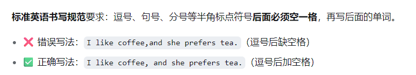
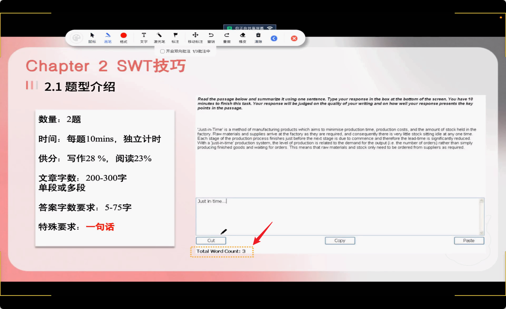
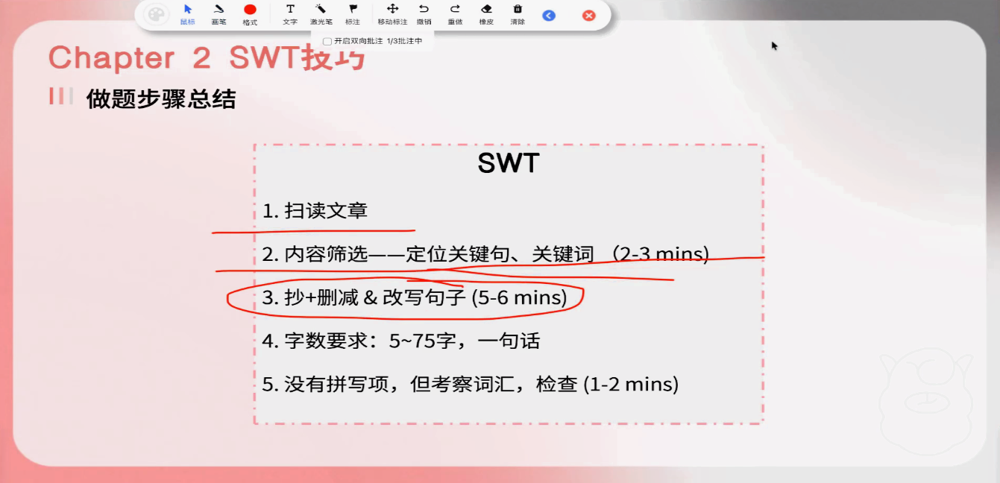
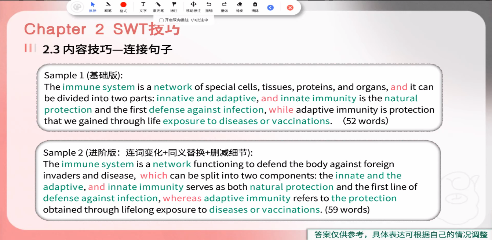

# SWT做题策略

1、务必不要超过 **75** 个字，左下方有字数统计，注意观察

2、务必不要出现两个 **句号**，否则直接 0 分

3、必须使用连词/关系词连接句子

4、每个连词之间必须是完整的一句话

5、有且只有一个句号

6、首字母大写，结尾句号

7、评分纬度：内容、格式、语法、词汇

8、无法复制原文，只能复制自己打出来的字

9、不能使用 however、therefore，否则判定语法错误

10、连词之前需要有空格，否则扣分



11、在了解做题规则和做题策略之后，自己去做几道模拟题


> SWT 是写作中最简单且最容易拿到满分的一道题，并且占写作的分值很大。
> 自认为这道题不需要非得找出所有关键句，就可以拿到接近满分的分数，但需要注意以下几点。

## 1. 字数要求

- 字数要求：**5–75 字**
- 建议大家尽量写到 **65–75 字**

## 2. 格式要求

- 开头首字母大写。
- 有些专有名词原文大写，在打字时也不要忘记大写。
- 有些专有名词或主题词前面会有 **the**，这个 **the** 一定一定一定不要忘记。

## 3. 标点符号

- 全文只有一个 **“.”**，其他都用 **“,”** 连接。
- **英文标点下的 “,” 后面要空一个格再打下一个词；既不要多打一个空格，也不要少打一个空格。**

## 4. 句子选择

- 尽量选长一些的句子。

## 5. 逻辑连接词

- **and, but** 不用。
- **but** 换成 **while** 或 **whereas**。
- **because** 换成 **since**，且 **since** 后面加的是句子，不是短语。

### 句式模板 1

遵从以上几点，这个句子就变成了：

```text
句子1 since 句子2, while 句子3, whereas 句子4.
```

### 句式模板 2

还有能力的培生可以做以下改变：

```
主题词, which + V. + 宾语, V. + 宾语, while 句子3 since 句子4, whereas 句子5.
```

这个结构肯定也够 **65–75 词**。

## 6. 语法错误

注意检查：

- 时态
- 三单
- 主谓一致

## 7. 同义词替换

- 有能力的培生可以换词。
- 我没有换词。

## 8. 时间要求

- 这道题有 **10 分钟**。
- 如果打字、句子和记得使用连接词都十分熟练，打字部分应该在 **5 分钟**就可以全部完成。
- 用 **2–3 分钟**仔细检查是否有打错的情况。
- 剩余 **3–2 分钟**打 WE 模板。

## 9. WE 模板

- 左上角倒计时剩 **30s** 就不要再打模板了。
- 把模板复制好，先粘贴试一下是否复制好了，然后再 **Next**。

## 10. 稳定的做题步骤很重要

- 用自己最舒服的固定连接词。
- 在平时练习时，我不会直接复制粘贴，我会自己打字卡时间。
- 所以我每天最多最多只做 **4 个 SWT**，两个一组。
- 做完后会在后面默写 WE 模板。
- 基本上两个 SWT 做完后，我的 WE 模板也都可以默写完。
- 因为我不改词，所以 **🌟 的评分是 8.5 分，满分是 9 分**。








